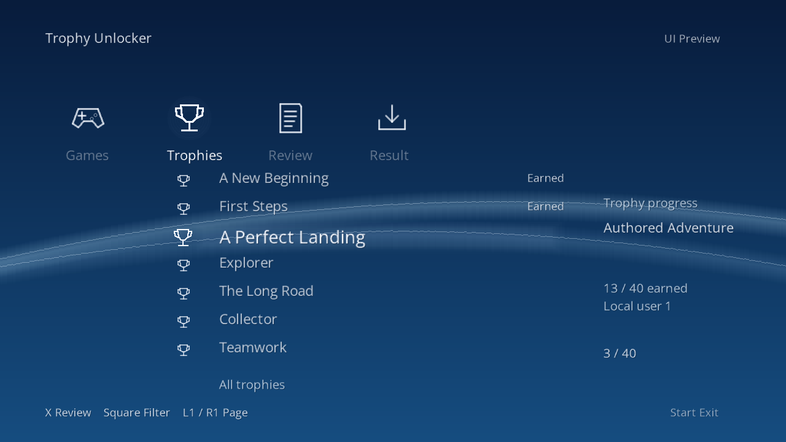

> **New test release:** [Saber PSN Unlock Tool v0.0.51 — CFW + HEN](https://github.com/richard1222/PS3-Trophy-Unlocker-2026/releases/tag/v0.0.51). Includes the connected all-games review and controlled award flow, separately labeled CFW/HEN packages, instructions and checksums. **Full controller-flow and real-hardware validation remain pending.**

> **Unlock All development update (October 27, 2026):** The award stage passed a disconnected emulator test across **two authored trophy sets in four guest launches**: three regular trophies plus automatic platinum per game, with existing earned progress preserved and saved results verified. **Unlocking across every game in one operation is still under development.** Current test downloads: [CFW/HEN v0.0.51](https://github.com/richard1222/PS3-Trophy-Unlocker-2026/releases/tag/v0.0.51). See [current progress and remaining work](docs/UNLOCK-ALL-PROGRESS-2026-10-27.md).

> **Artwork/build status (October 26, 2026):** The approved icon and background are embedded in the rebuilt development PKG. The installed app and artwork files now match the extracted package in console readback checks. Actual appearance is a separate visual check. Existing public releases are unchanged.

# Saber PSN Unlock Tool

A project by **Richard1222/Saber** to browse and unlock PlayStation 3 trophies. The development target is **Evilnat 4.93 CFW**.

> **Digital-game milestone (October 26, 2026):** An additional digital PS3 title completed **34/34 trophies**. Stable saved-file checks independently verified all 34 locally; the final app report records successful completion and clean cleanup. The owner subsequently confirmed that manual **PSN synchronization worked**. PSN success is owner-reported, not independently queried. This extends testing beyond Persona 5; compatibility with every game and real HEN hardware remains unverified. See the [digital test result](docs/DIGITAL-GAME-RESULT-2026-10-26.md).

> **Local Unlock All milestone (October 26, 2026):** The v0.0.45 development UI completed Persona 5’s remaining 48 trophies on the owner’s PS3, including automatic platinum. Independent, identical repeat reads of the saved files confirm **49/49 earned**, unchanged trophy metadata and preservation of the previously earned trophy. The final console report records successful completion and clean cleanup. **PSN synchronization of this full batch is not yet tested.** See the [local bulk verification](docs/PERSONA5-LOCAL-BULK-2026-10-26.md). A separately labeled HEN test package has passed package and disconnected emulator-startup checks; real HEN compatibility remains unverified. **CFW and HEN test packages:** [Saber PSN Unlock Tool v0.0.45 release](https://github.com/richard1222/PS3-Trophy-Unlocker-2026/releases/tag/v0.0.45). XMB titles are **Saber PSN Unlock Tool** and **Saber PSN Unlock Tool HEN**. Game-specific setup is required; the packages do not include it.

> **Verified award milestone (October 25, 2026):** The owner confirmed successful synchronization and PSN visibility for Persona 5’s “Merciless Executioner,” following the independently verified local award and restart persistence. An earlier `80022D1E` sync failure is retained in the evidence; its exact cause is unconfirmed. See the [owner-confirmed PSN milestone](docs/OWNER-CONFIRMED-PSN-2026-10-25.md). The earlier public preview was [v0.0.10](releases/v0.0.10/README.md); current CFW/HEN downloads are linked above.

Updated October 27, 2026.

> **XMB-style UI progress (October 25, 2026):** The owner confirmed menu display/navigation on PS3, and the backup retest recorded verified completion. v0.0.37 adds **Check selection**: an earned trophy was rejected and a locked trophy produced a plan, with both paths recorded in the console report. That historical v0.0.37 selection-check build had unlocking disconnected; the current development build’s local batch result is described above. See the [selection-check preview](docs/UI-SELECTION-V037-2026-10-25.md).

> **Earlier October 25 milestone:** First-status cancellation passed on the owner's PS3 with unchanged trophy files. The later completed-registration result above has different preservation findings. See the [historical cancellation result](docs/HARDWARE-CANCELLATION-2026-10-25.md).

## Current progress

| Feature | Evidence |
| --- | --- |
| Browse trophy sets and individual trophies | Tested on one PS3 |
| Menu-based selected unlock flow | Connected in the development UI; broader real-console validation pending |
| Unlock all remaining trophies in one game | Persona 5: 49/49 locally verified; full-batch PSN sync pending. Additional digital title: 34/34 locally verified and owner-confirmed manual PSN sync. |
| Unlock trophies across every game in one operation | App controls connected in development source. Two-game native sequence and fresh review screen passed in the emulator; full controller/hardware validation pending. |
| Create a complete-set backup | Console result and file-integrity checks passed |
| Backup persistence | One owner-reported normal restart followed by successful integrity checks |
| Recover into a new scratch folder | Console result confirmed; 83 copied files / 3,672,696 bytes passed separate integrity checks |
| Compare that scratch copy against backup and live originals | Follow-up interrupted by FTP timeouts; pending |
| App-owned read-only context setup/cleanup | v0.0.22 hardware diagnostic passed on one PS3 (18 report fields) |
| App-owned writable context setup/cleanup | v0.0.27 hardware report, installed payload and four-file comparison passed |
| Guarded native trophy-state query | v0.0.25 two-cycle hardware report, installed payload and independent four-file comparison passed |
| Registered-context trophy queries | Native selected-trophy details and 49-trophy flags passed; three-file preservation failure retained |
| Unlock a selected trophy | One native Persona 5 award verified by API readbacks and independent saved-file parsing |
| Unlock persistence | Local award retained after an owner-confirmed normal restart; all 57 files match post-error backup |
| Restore to a live trophy folder | Not implemented or tested |
| PSN synchronization | Owner confirmed successful sync and PSN visibility for one Persona 5 trophy after an earlier error |

These are results for the tested console and trophy sets, not universal compatibility claims.

## Releases

**Current CFW/HEN test packages:** [Saber PSN Unlock Tool v0.0.51](https://github.com/richard1222/PS3-Trophy-Unlocker-2026/releases/tag/v0.0.51). This is a development prerelease. The earlier v0.0.45 release remains available.

[v0.0.10 development progress](https://github.com/richard1222/PS3-Trophy-Unlocker-2026/releases/tag/v0.0.10-dev-preview-20261023) records an earlier public development milestone. This public release contains a progress report and public source snapshot, with no installable PKG attached.

Earlier development notes remain in [releases/](releases/). They describe their own point in development and may predate newer results.

## Development milestone (October 25, 2026)

- **Proven:** v0.0.27 created and cleaned up a writable-capable context and handle on one PS3, with no retained resources. Installed payload and independent four-file comparisons passed.
- **Proven:** v0.0.25 previously completed two read-only query/cleanup cycles, each returning49 trophies. The selected trophy remains locked in the unchanged record.
- **Proven:** registered-context queries identified the selected trophy and returned 49 locked trophies on the owner's PS3. Cleanup succeeded; three of 57 collected files changed.
- **Inference:** the query result supports a bounded single-trophy hardware test; it does not prove unlocking or data integrity.
- **Proven:** exactly one selected trophy unlocked, its timestamps were saved, and the other 48 decoded trophy records were unchanged in two complete collections. Cleanup and XMB return passed.
- **Proven:** the local award survived an owner-confirmed normal restart. Persona 5 loads normally while signed out.
- **Owner-confirmed:** successful synchronization and PSN visibility for the selected Persona 5 trophy. No independent PSN profile readback was captured.
- **Unknown:** exact sync-error cause, independent protection-file integrity, general callback lifetime, broader PSN compatibility and HEN runtime compatibility.
- **Next:** retain the successful result and earlier failure, then plan a separate bounded validation case. The completed award test remains disabled.

All public milestones remain development previews. The measured single-trophy result is not a general compatibility claim or a new end-user release.

## Roadmap

The current goal is **one operation across every game in the profile**, including registered digital and disc titles. This is not finished yet.

1. Validate controller input and the final dialog around the connected all-games flow.
2. Test cancellation, changed files and interrupted saves without repeating uncertain awards.
3. Finish installed-app preservation and validate the complete flow on a bounded console test.
4. Validate separately on real CFW and HEN hardware before a new release.

Local saved results and PSN synchronization are separate checks. The existing owner-confirmed PSN milestones remain limited to the tests described above.

## Compatibility

Development target: **Evilnat 4.93 CFW**. Current console and emulator firmware metadata report **4.93**; full real-console validation of the new v0.0.51 build remains pending. The separately labeled HEN package has build and disconnected emulator results; real HEN hardware compatibility remains unverified.

## Credits

Project creator: **Richard1222/Saber**.

Research builds on publicly available PlayStation homebrew documentation and developer-maintained source. Existing contributor credits and licenses in the public source remain applicable.

## License

Original project code is licensed under the [MIT License](LICENSE), copyright
2026 Richard (Richard1222/Saber). Third-party components retain their own
terms; see [Third-party notices](THIRD_PARTY_NOTICES.md) and the full notices
in [licenses/](licenses/).
