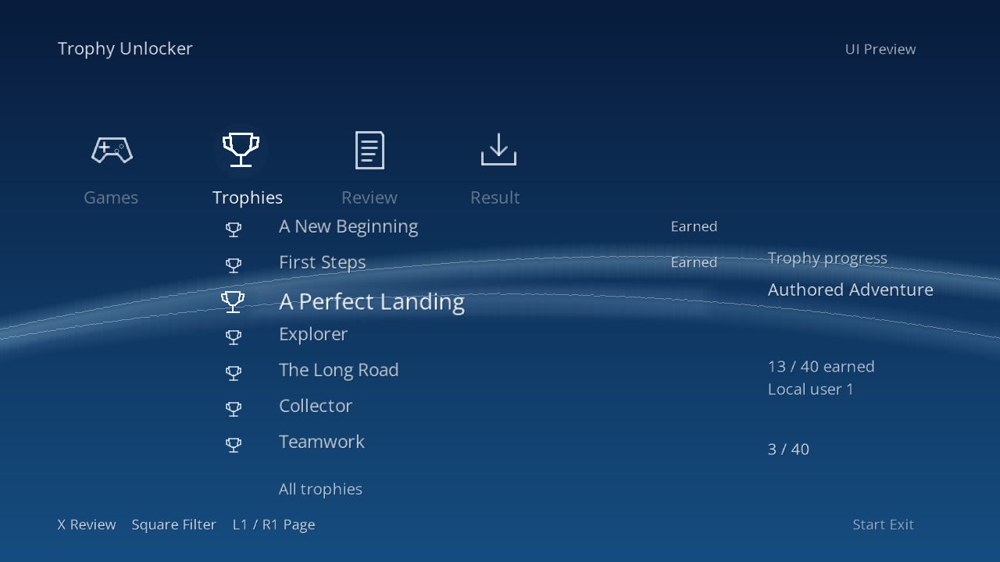

# Saber PSN Unlock Tool

An XMB-style PS3 trophy browser with backups, individual and per-game unlock workflows, and reviewed selection across registered games. Built for **Evilnat 4.93 CFW**, with a separately labeled **HEN test package**. **Credit to Richard1222 / Saber.**

Selected-game unlocking and owner-operated PSN sync have succeeded on hardware. A completed award run across every registered game remains unverified; HEN hardware testing is pending.

---

## Contents

- [Current development](#current-development)
- [Features](#features)
- [Quick start](#quick-start)
- [Screenshots](#screenshots)
- [Progress chart](#progress-chart)
- [Validation](#validation)
- [Repository layout](#repository-layout)
- [Credits and license](#credits-and-license)

## Current development

**v0.0.62 test release · November 6, 2026.** [Download CFW or HEN packages](https://github.com/richard1222/PS3-Trophy-Unlocker-2026/releases/tag/v0.0.62) · [Detailed status](docs/STATUS.md)

This build includes the approved Saber/Artoria trophy icon and corrected “Saber PSN Unlock Tool” XMB background. It retains v0.0.61's reviewed skip list: when matching setup is genuinely absent, you can review every affected game and explicitly exclude those games from a job. Damaged or partial setups remain blocking errors.

| Current evidence | Result / limit |
| --- | --- |
| Physical installation | v0.0.61 CFW independently verified; v0.0.62 hardware test pending |
| Latest complete hardware library check | 25 registered sets; 1,268 remaining; 5 missing setups at that time |
| Subsequent World at War test | Matching setup accepted; preparation cancelled with 0/65 unchanged |
| Remaining setup gaps | 4 projected after that test; a fresh whole-library check is still needed |
| Uninitialized installed digital sets | 15 explicitly excluded in the historical check; separate from missing-setup exclusions |
| Whole-library awards | Not yet validated |

The historical full-selection count is not the remaining count for a new selection with exclusions. Excluded games receive no awards in that job. A readiness check, preparation and the final award confirmation are separate steps; PSN synchronization remains manual.

## Features

- **XMB-style browsing:** controller navigation, game lists, trophy lists and review screens.
- **Backups:** preserve trophy state before a state-changing operation.
- **Individual trophy review:** distinguish already-earned and locked trophies before a fresh confirmation.
- **Per-game Unlock All:** reviewed batches with saved-state verification and preservation of prior earned records.
- **Reviewed missing-setup exclusions:** inspect every listed game and explicitly choose a reduced selection; the default answer is No.
- **Registered-games-only selection:** separately review installed digital sets that lack local trophy initialization.
- **Disc and digital discovery:** include eligible PS3 titles; PS1/PS2 Classics are excluded from the PS3 trophy scan.
- **Registration checks:** stop before new review/awards if registration changes trophy definitions, earned flags or timestamps.
- **Separate HEN identity:** a clearly labeled HEN test app with storage separate from the CFW app.

## Quick start

1. Read [Current status](docs/STATUS.md) and the [v0.0.62 release notes](https://github.com/richard1222/PS3-Trophy-Unlocker-2026/releases/tag/v0.0.62).
2. Choose the package labeled **CFW** or **HEN** for your environment and compare its SHA-256 with the release checksum file.
3. Open Saber and browse the game and trophy lists.
4. Press **Square from Games** for All Games. Review any digital exclusions and missing-setup exclusions separately.
5. Let the check finish. For the next validation test, stop at its result without preparing or confirming awards.

Use **Circle** to go back and **Start** to exit. Keep backups and existing reports when updating an installed test build.

[Report a bug](https://github.com/richard1222/PS3-Trophy-Unlocker-2026/issues/new)

## Screenshots



*Historical v0.0.36 UI image. It illustrates the browsing layout; it is not a v0.0.62 hardware capture. The new release includes updated XMB icon and background artwork.*

## Progress chart

| Workstream | State | Evidence / limit |
| --- | --- | --- |
| Browsing and controller navigation | Hardware-tested in earlier CFW builds | New skip-list flow needs a physical test |
| Individual / per-game trophy workflows | Selected-game results | Includes owner-confirmed PSN sync; title-specific |
| Missing-setup skip list | Local regression checks pass | Explicit review, persisted selection and worker rechecks; hardware flow pending |
| World at War preparation | Hardware passed | Cancelled before awards; 0/65 preserved |
| Super Heroine Chronicle | Single award verified | 13 prior trophies preserved, 14/40 saved; owner confirmed sync |
| Whole-library award completion | Not validated | Preparation and readiness are not a completed award run |
| v0.0.62 CFW / HEN packages | Inspection and emulator startup pass | No v0.0.62 physical result; real HEN untested |

## Validation

The audited v0.0.61 application passed **85 unique automated test methods**, with no skips:

| Group | Methods |
| --- | ---: |
| Native session lifecycle | 18 |
| Per-game batch lifecycle | 13 |
| Library planning, storage and recovery | 36 |
| Report summaries | 4 |
| Digital discovery | 9 |
| UI rendering / runtime / Unicode | 3 |
| Native setup validation | 2 |

A final native input-guard audit also passed address- and undefined-behavior sanitizer checks. Tests cover corrupted selections, changed excluded-game state, newly present setups and registration changes.

v0.0.62 retains that application logic, changing version markers and artwork. Both new packages passed strict payload, executable/import, identity, firmware, image and notice checks. Their extracted payloads reached UI startup and digital discovery in disconnected RPCS3 with firmware 4.93. Authored trophy/digital fixtures remained unchanged and no trophy API calls occurred. Each interactive UI was stopped by the host after 20 seconds; these were not controller, dialog, award or clean guest-exit tests.

Release binaries were built locally. The public tag documents the release; it does not claim the current public source tree reproduces these binaries.

## Repository layout

```text
README.md       Project overview, features and current limits
docs/           Current status, historical milestones and existing UI images
releases/       Historical release documentation and files
.github/        Existing repository workflows
LICENSE         MIT license
```

The latest status supersedes older milestone pages. Historical releases and evidence retain their original dates.

## Credits and license

**Richard1222 / Saber** — project credit, integration and testing.

This repository uses the [MIT License](LICENSE). Existing third-party notices and their original terms remain applicable. This is an independent homebrew project; no Sony or PlayStation affiliation is implied.
