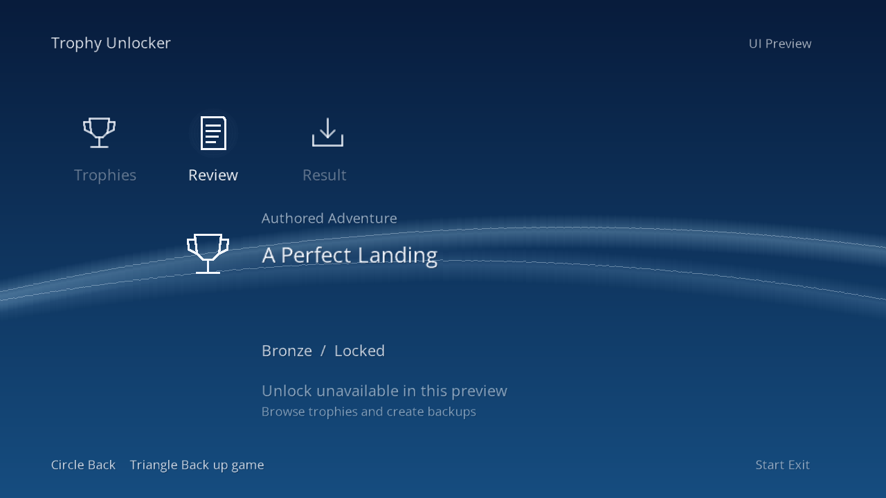

# XMB-style console UI preview — October 25, 2026

The v0.0.36 preview now follows the PS3 XMB's visual structure: a horizontal icon bar, centered vertical selection, original blue wave artwork, soft white text and a subtle selection glow.

*Rendered by the shared UI code with authored example data. This is not a capture from a PS3.*

## Controls

- Up/Down: select an item.
- Right or Cross: open a game or review a trophy.
- Left or Circle: return to the previous screen.
- L1/R1: page a list.
- Square: cycle All, Locked and Earned filters.
- Triangle: back up the selected game, after confirmation.
- Start: exit.

## Verified

The native package compiled successfully. All14 workflows passed; the full build and review suites each passed800 tests with one explicit skip. Navigation bounds, horizontal screen transitions and framebuffer guards passed. Six authored screen states were rendered and checked.

The actual packaged executable reached UI-ready during a bounded, disconnected emulated startup check. All57 copied trophy files remained unchanged, with no native trophy calls. The interactive test was deliberately stopped after20seconds.

The font and icons were replaced for the XMB-inspired appearance. The font is Open Sans under the [SIL Open Font License](../licenses/OpenSans-OFL.txt); icons and waves are original artwork. No Sony font or artwork is bundled.

## Still in development

The UI's unlock action remains unavailable until its selectable-award integration is validated. Real-console display/controller behavior, backup execution through the new screen, HEN runtime and frame-rate performance are not yet verified. The wave background is static; unsupported text characters use a fallback glyph.

The separately measured native trophy award, restart persistence and owner-confirmed PSN visibility remain documented in the [PSN milestone](OWNER-CONFIRMED-PSN-2026-10-25.md). No new general end-user UI release is announced.

Next is a real-console UI test, followed by separately validated selected-trophy integration. The implementation stays private. Public release remains v0.0.10 development preview.

[Earlier UI preview and test history](https://github.com/richard1222/PS3-Trophy-Unlocker-2026/blob/1d151bdf0310b0b0f6e2aa12c40df200858350b5/docs/UI-DEVELOPMENT-2026-10-25.md).
