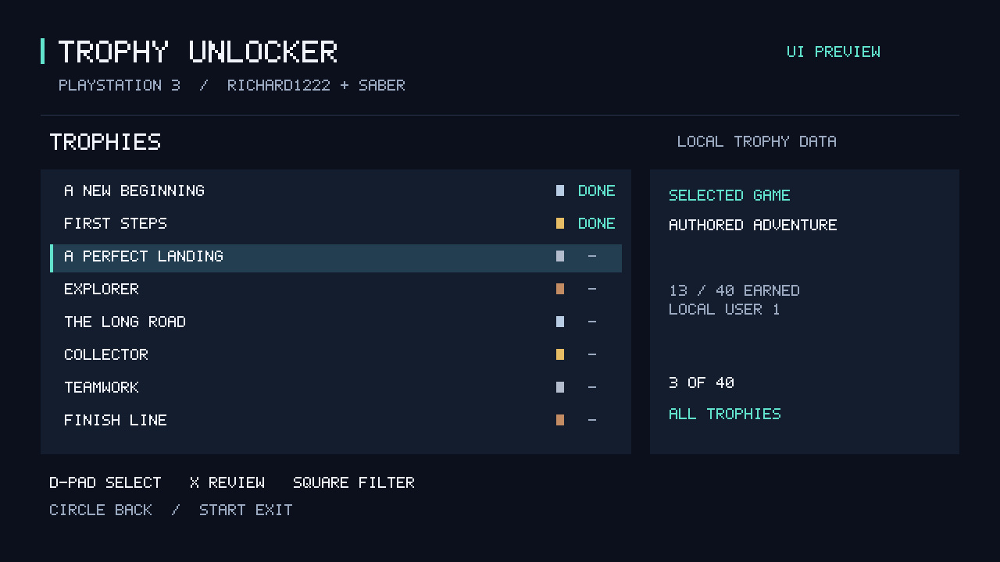
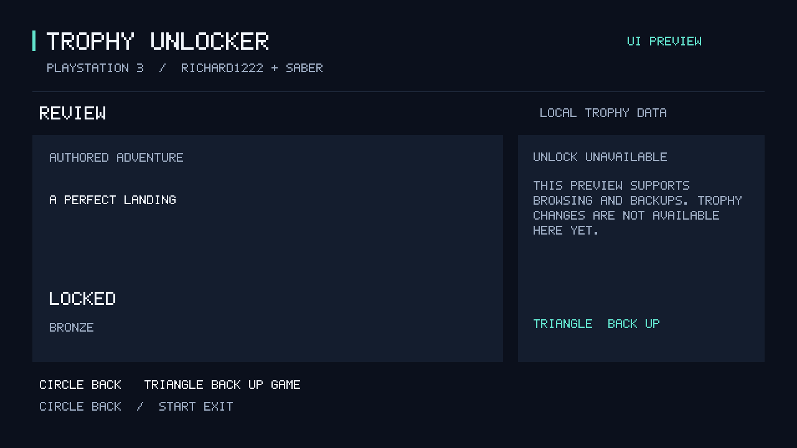

# Console UI preview — October 25, 2026

The first controller-driven UI preview now builds. It provides a game list, trophy browsing, locked/earned filters, a selected-trophy review page, and backup controls with confirmation.

*Preview from the shared UI renderer using authored example data. This is not a photo or screenshot from a PS3.*

## Verified so far

- The native PS3 package compiled successfully.
- All14 CI workflows passed. The full build and review suites each passed800 tests with one explicit skip.
- Cursor boundaries and framebuffer memory guards passed; six authored screens rendered and were visually checked.
- The actual packaged executable reached its UI-ready state in a disconnected headless emulator check. All57 copied trophy files remained unchanged. The interactive process was deliberately stopped after the bounded check.

## Current limits

The UI does not yet perform trophy awards. Its review page clearly labels unlocking as unavailable. The separately tested prototype's successful native award, restart persistence and owner-confirmed PSN visibility remain documented in the [PSN milestone](OWNER-CONFIRMED-PSN-2026-10-25.md).

Real-console UI display and controls, controller interaction in the emulator, backup execution through the new screen, selectable-award integration and HEN runtime remain unverified. Basic text uses a small uppercase font; unsupported characters display a fallback glyph. No general end-user UI release is announced.

An initial native build caught a long-name formatting bound; it was fixed. The first emulator attempts used an unprocessed debug ELF and did not establish startup. The packaged executable was tested separately. A report-file lock interrupted an initial operator run; the corrected bounded check read the report after closing the process. These failures remain in the development record.

## Next

Test the UI on real hardware, then integrate and validate exactly one selected trophy while preserving existing earned records. Keep the previous completed award disabled.

The implementation remains private. The public release remains v0.0.10 development preview.
