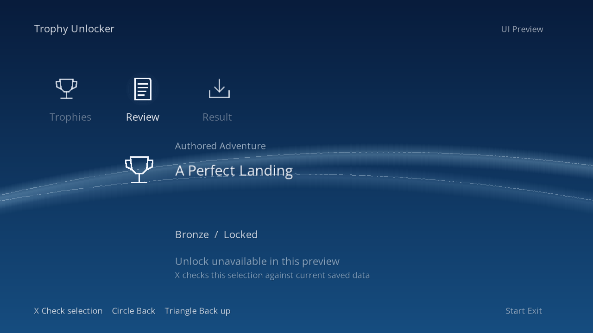
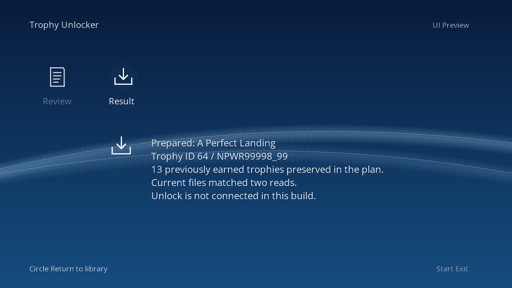

# Selection-check UI v0.0.37 — October 25, 2026

The XMB-style preview now lets you check a selected trophy against its current saved data. Open a game, open a trophy's review screen, then press X again to check the selection.

*Both images use authored example data rendered by the shared UI code. They are not PS3 screenshots.*

## Current truth

**Proven:** the package builds and all 14 workflows passed. The full build and review suites each completed 807 tests: 806 passed, one explicit skip. Selection checks and simulated transaction cases passed on Linux and Windows. The exact packaged executable reached UI-ready during a disconnected emulator startup check, with all 57 copied trophy files unchanged and no native trophy calls.

**Owner-confirmed:** the previous v0.0.36 menu displays and navigates correctly on their PS3; its backup retest recorded verified completion and return to the XMB. The new v0.0.37 preview is installed. The owner reports “Already earned” for the earned trophy and a Prepared result for a locked Persona 5 trophy, with current files matching two reads. The final run report records both a blocked selection and a prepared selection, followed by return to the XMB. The exact trophy name and ID are owner-reported.

## What the check means

An already-earned trophy is rejected. A locked trophy may produce a plan after its game metadata and saved state pass validation. Preparing a selection does not award it. Direct platinum and potential automatic-platinum cases are blocked.

The successful earlier Persona 5 award and owner-confirmed PSN visibility remain a separate milestone. This menu still says **Unlock is not connected in this build**.

## Next

Connect the verified selection to the native award flow, then validate it separately. HEN runtime, broad compatibility, frame-rate performance and backup restoration remain unverified. The public release remains the earlier development preview; no public v0.0.37 PKG is attached.
