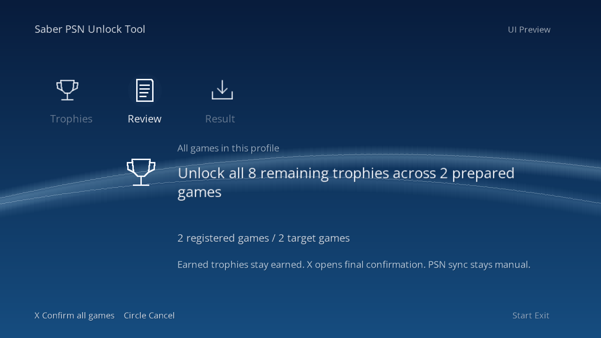

# Unlock All progress — October 27, 2026

The award stage now passes a disconnected emulator test, including verification of saved results and preservation of previously earned trophies. **One operation across every game is still under development.** The new CFW/HEN development prerelease is [Saber PSN Unlock Tool v0.0.51](https://github.com/richard1222/PS3-Trophy-Unlocker-2026/releases/tag/v0.0.51).

## Verified in development

- Four fresh emulator guest launches completed two preparations and two native award runs across two authored sets.
- Preparation awarded nothing. Each award run earned three remaining regular trophies plus automatic platinum and preserved its previously earned trophy.
- Both saved results were independently checked, recorded, reread and verified. The multi-game job reached **Complete**, with both sets at **5/5 earned**.
- The second game's worker checked the first game's recorded saved result before starting.
- The existing full host suite collected 926 tests: **925 passed, one skipped, no failures**. It was not rerun for the diagnostic-only additions.

This proves the native multi-game backend sequence for two synthetic fixtures in a disconnected emulator. **Global review, final confirmation and launch controls are now connected in development source. Full controller/dialog/award interaction remains unverified.** The native control-API test used an authored-only consent marker; it does not prove physical button interaction.

The fixture results do not establish support for every retail game, real HEN hardware or PSN acceptance. This was a headless test; no new app screenshot or controller-navigation result is claimed.

## Existing real-console results

- Persona 5: **49/49 locally earned**, independently verified. Full-batch PSN synchronization remains unconfirmed.
- Additional digital PS3 title: **34/34 locally earned**, independently verified; the owner confirmed successful manual PSN synchronization.
- Earlier Persona 5 selected-trophy test: the owner confirmed “Merciless Executioner” appeared on PSN after an earlier sync error.

## Package candidates and app review

**[v0.0.51 CFW and HEN test packages](https://github.com/richard1222/PS3-Trophy-Unlocker-2026/releases/tag/v0.0.51) are published.** Both passed actual final-package extraction, identity/artwork/notice checks and disconnected emulator startup with unchanged test trophy files and no trophy API calls. HEN has its own XMB title and storage ID. Publication does not establish installation or real-console validation. Real HEN testing remains pending.

The actual app displayed a freshly verified review for two prepared games and eight remaining trophies without awarding anything. This is an exported software frame from an authored smoke test. The controller-connected label was simulated for the illustration; physical input and GPU appearance are not proved.

The app rechecks the complete displayed review after explicit consent, preserves verified backups/results, stops on uncertain work and does not automatically retry or sync to PSN. These safeguards are not a brick-proof or zero-risk guarantee.

## What remains

The next work is testing controller input, the actual final dialog, cancellation and ordinary-launch recovery around the connected app flow, then completing preservation before a bounded real-console test. A complete multi-game test is required before a new package release. Registered digital and disc titles are within the goal; universal game compatibility has not been demonstrated.

There is no reliable completion date yet. The goal remains **Unlock All across every game in one operation**, rather than requiring a separate operation for each game.

## Firmware and downloads

The development target is **Evilnat 4.93 CFW**. Current console/emulator firmware metadata report **4.93**; full real-console validation of the new v0.0.51 build remains pending. HEN has a separately named test package and disconnected emulator checks, with real HEN testing pending.

[Download Saber PSN Unlock Tool v0.0.51 CFW/HEN test packages](https://github.com/richard1222/PS3-Trophy-Unlocker-2026/releases/tag/v0.0.51). The prior v0.0.45 release and its separate real-console milestones remain available.
